# 进制计数制及其数据之间的相互转换

## 一、进制计数制

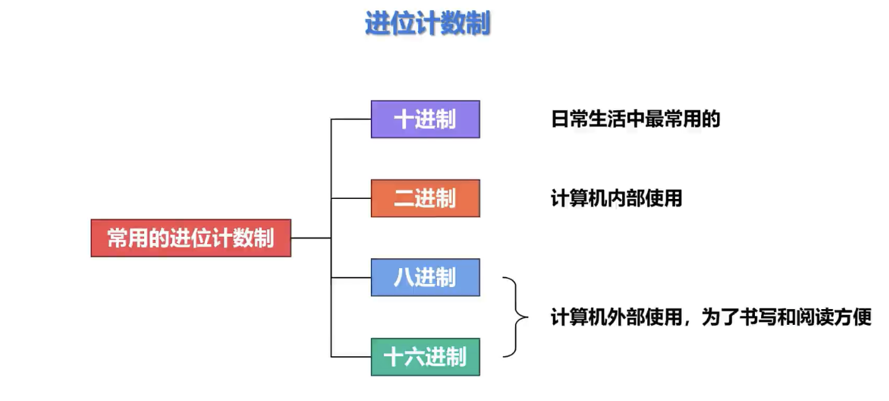

### 1.1 十进制

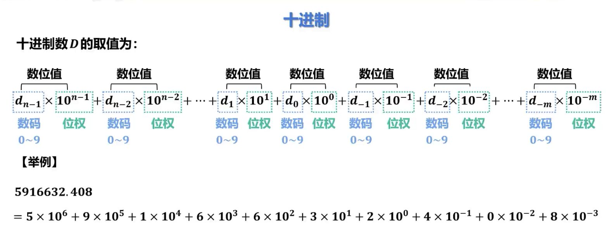

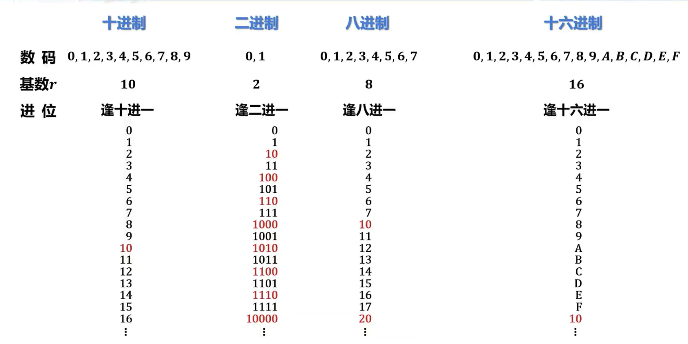

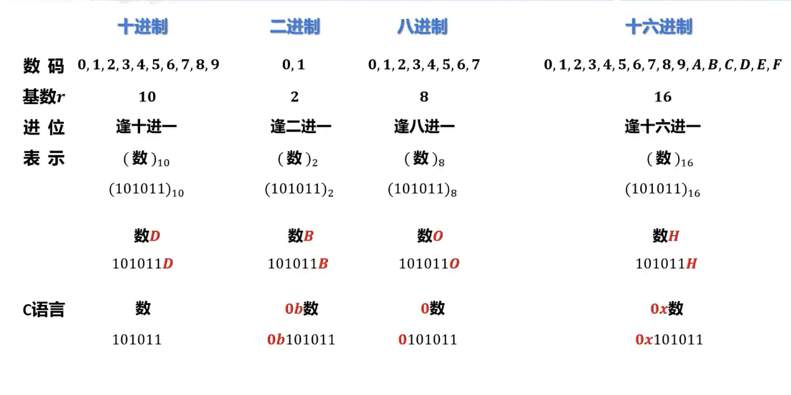

## 二、数据之间的相互转换

### 2.1 任意进制   -->    十进制

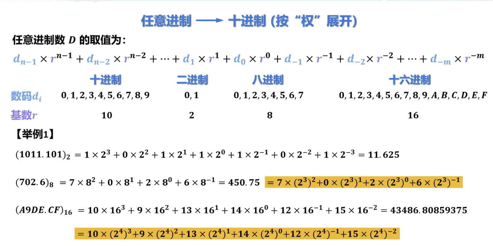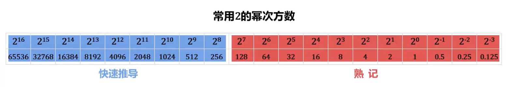

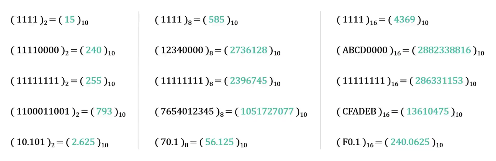

### 2.2  二进制   -->    八/十六进制

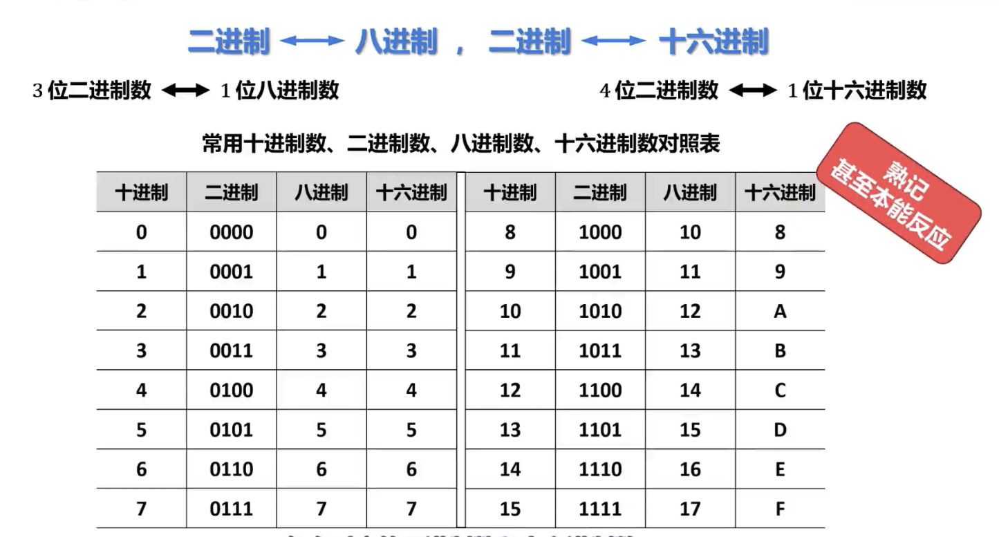

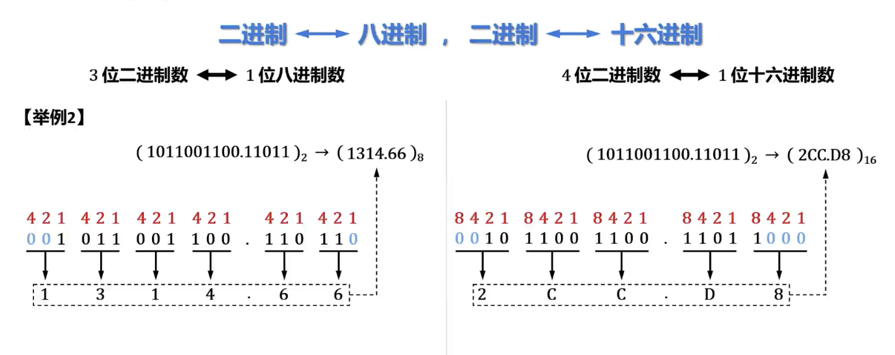

### 2.2  八/十六进制   -->   二进制

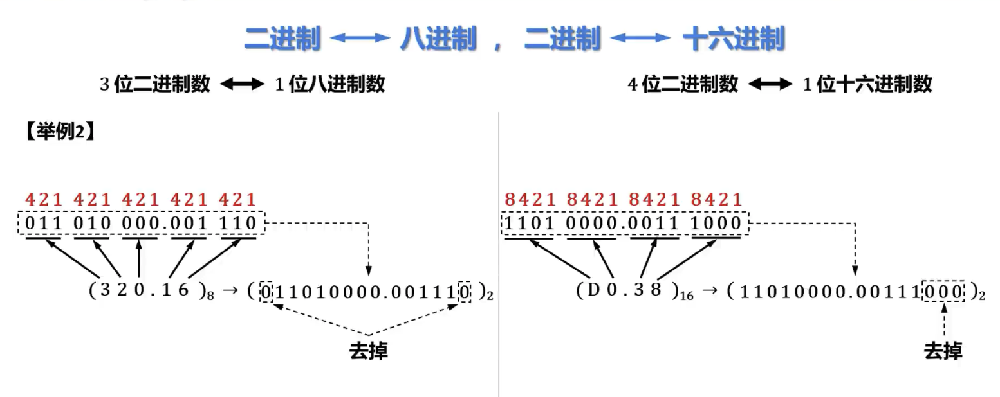

### 2.3 总结

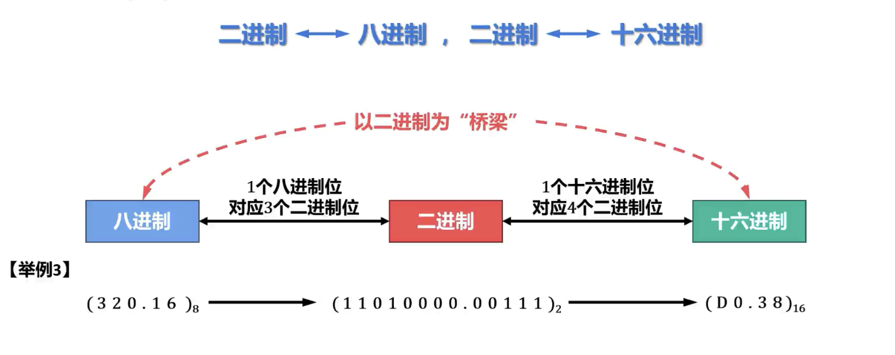

### 2.4 十进制  --> 任意进制

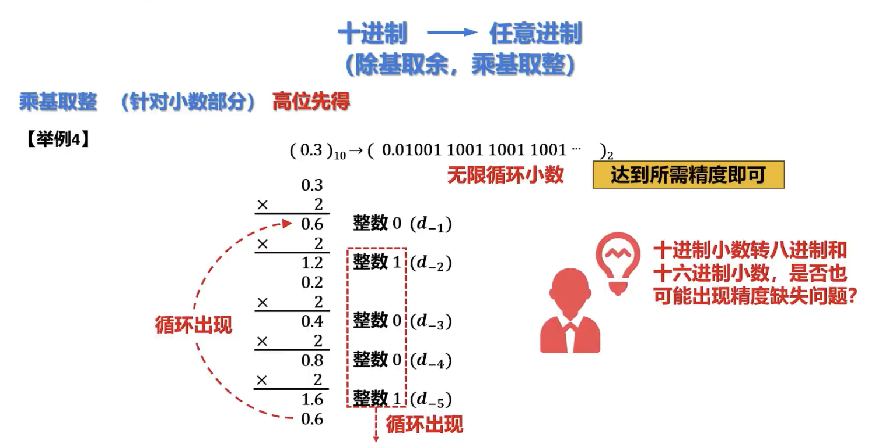

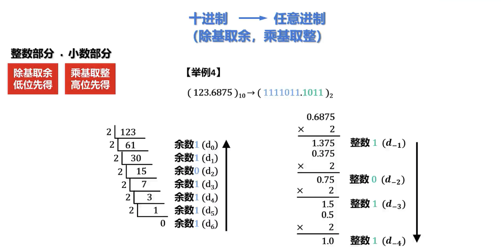

#### 2.4.1  十进制  --> 二进制 （凑值法)

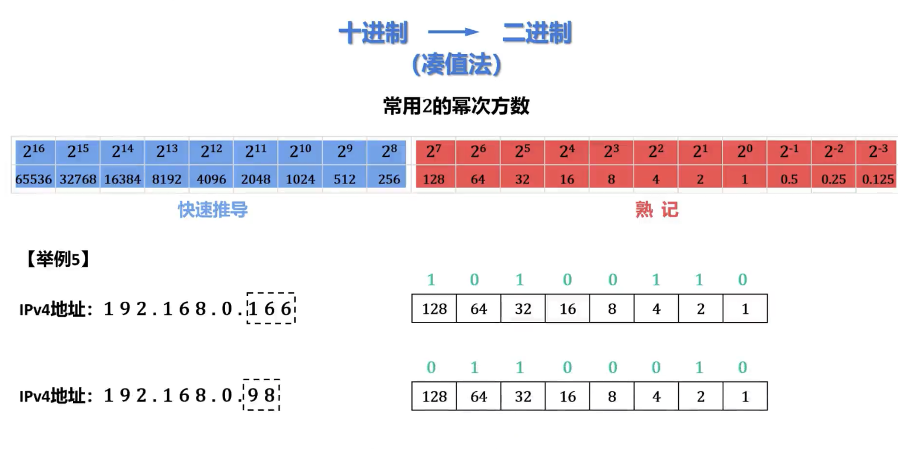
