# 第五节 函数极限计算：七种未定式

## 一、七种未定式

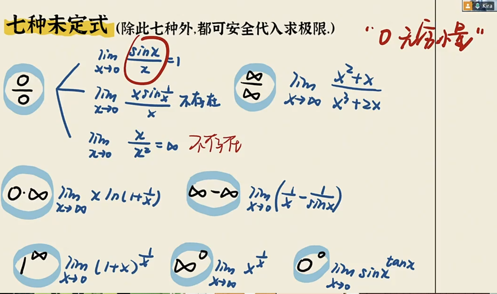

### 1.1 定义

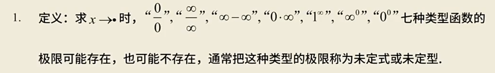

### 1.2 通用思路

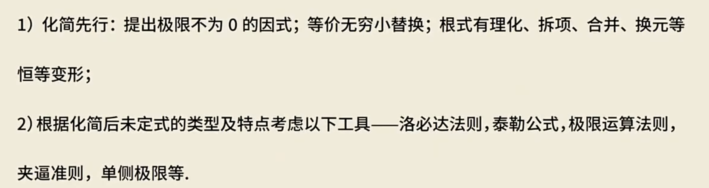

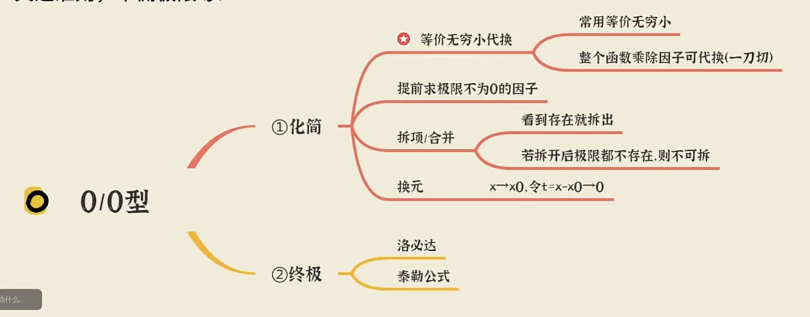

## 二、洛必达法则

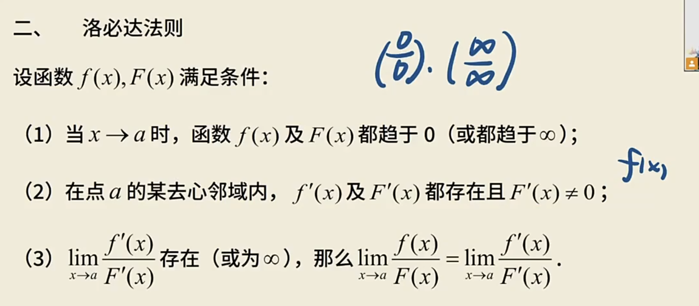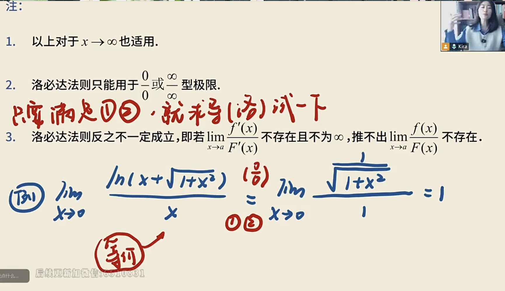

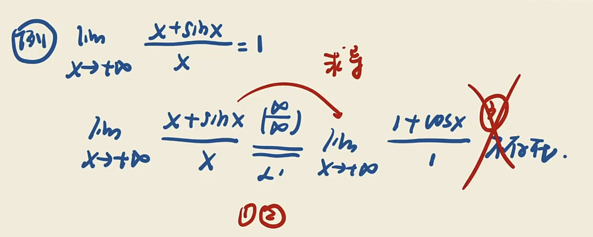

## 三、泰勒公式（麦克劳林公式)

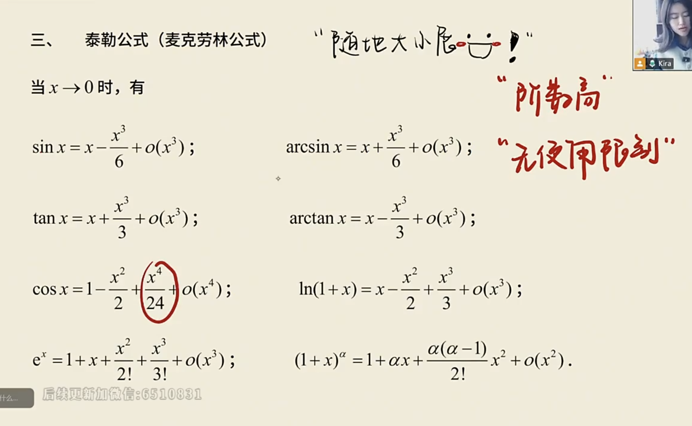

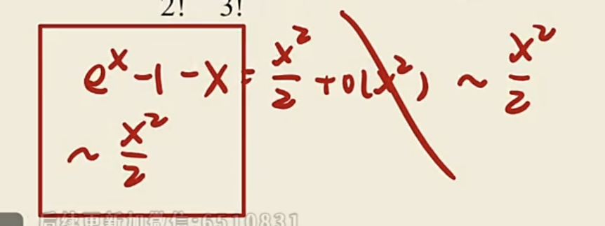

## 四、七种未定式题目

### 4.1  类型一  **$\frac{0}{0}$   型**

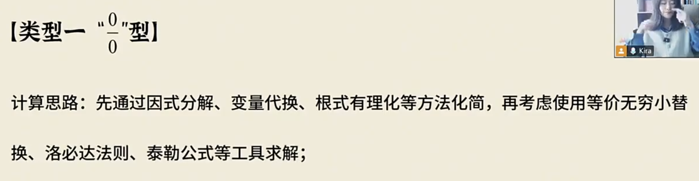

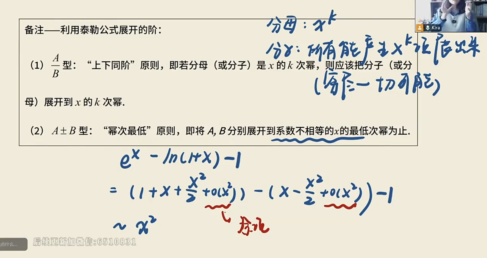

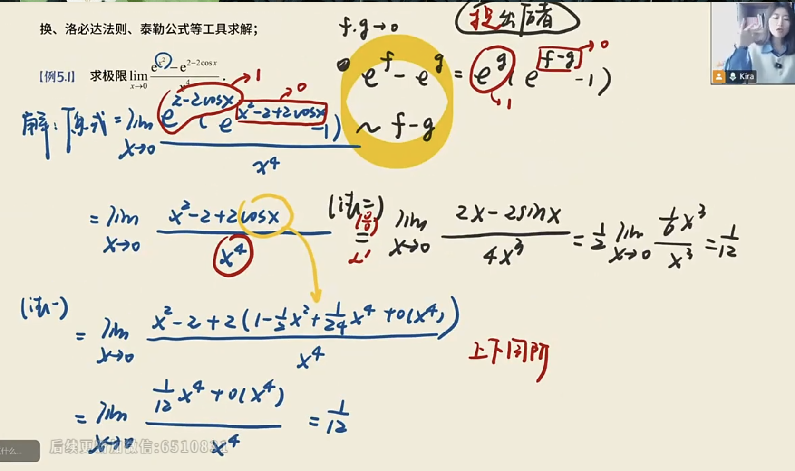

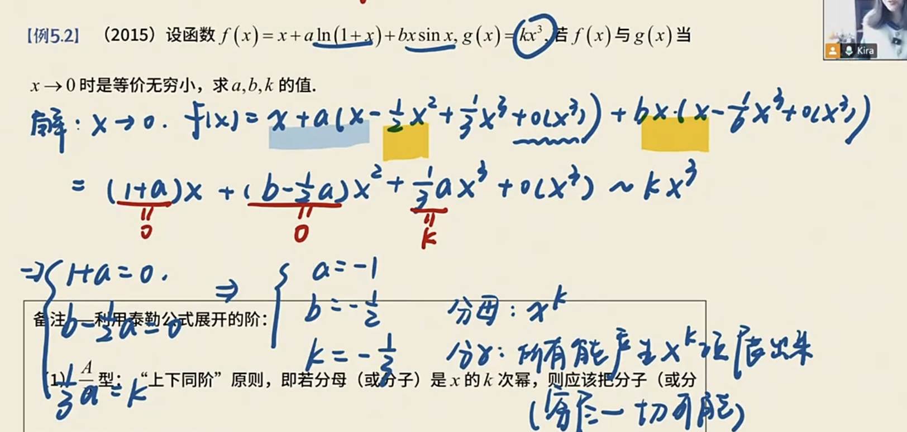

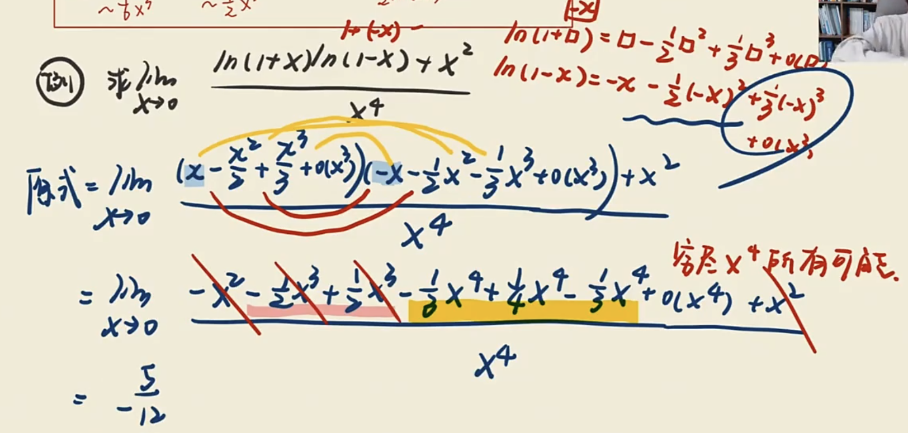

### 4.2 类型二  $\frac{\infty}{\infty}$  **型**
